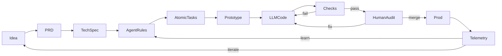

# AGENTS.md — Citadel

## Context Pointers
Read the authoritative doc before acting on its branch; never duplicate its details here:
- [Docs/PRD.md](./Docs/PRD.md) — product scope, user journeys, functional & non-functional requirements.
- [Docs/SPEC.md](./Docs/SPEC.md) — Rust crate stack, module layout, SQLite + FTS5 schema, MCP `query`/`manage` contracts, CLI, embedded UI, and container (Docker default, Apple `container` optional)/native deployment.
- [REVIEW.md](./REVIEW.md) — grounded verification & visual feedback loops (headless Chrome UI screenshots, MCP JSON-RPC probes, container smoke tests) and `HumanAudit` evidence format.
- `Docs/AtomicTasks/` *(created in AtomicTasks)* — ordered atomic task specs and acceptance criteria.
- [CONTEXT.md](./CONTEXT.md) — domain glossary (Source, Origin, Sync, Sync claim…); use these terms.
- [Docs/adr/](./Docs/adr/) — architecture decisions; settled unless explicitly reopened.

## Development Workflow
Typical development path used on this project *(reference guide, not a hard rule)*:



## Execution Loop
Follow `AtomicTasks -> LLMCode -> Checks -> HumanAudit` for every change:

1. **Red first (TDD):** Write a failing unit or integration test for the task or bug before writing production code.
2. **One atomic task:** Scope edits to a single task from `Docs/AtomicTasks/`; keep diffs tight and commit with one Conventional Commit once green.
3. **Checks gate (all must pass before `HumanAudit`):**
   ```bash
   cargo fmt --check
   cargo clippy --all-targets -- -D warnings
   cargo test
   ```
   When `Dockerfile` or `Makefile` changes, also build the image with Docker (the default runtime; ADR-0003). Never run Apple `container` as a check: it is beta, and its build VM cache grew to 98 GB and filled the host disk.
   ```bash
   docker build -t citadel:check .
   ```
   If any check fails, fix the root cause and re-run the full gate.
4. **HumanAudit handoff:** Summarize changed files, exact command results, and any risks or assumptions; wait for human review before merging.

## Engineering Invariants
- **Error handling:** Propagate errors with `Result`, `thiserror` (library modules), and `anyhow` (CLI/top-level); reserve `unwrap()` and `expect()` strictly for `#[cfg(test)]`.
- **MCP `stdio` purity:** Send all `tracing` logs to `stderr` or `daemon.log`; keep `stdout` strictly reserved for JSON-RPC frames in `citadel mcp`.
- **SQLite read-only boundary:** Execute every MCP `query` through `src/db/readonly.rs` (`SQLITE_OPEN_READ_ONLY`, `PRAGMA query_only = ON`, authorizer allowlist, 5s timeout, row/byte caps). Re-run the read-only safety tests after any `src/db/` change.
- **Source lifecycle validation:** Every entry point (CLI, UI, MCP, daemon) changes Sources only through `SourceLifecycle` in `src/sources/`, which enforces `http(s)://` URL checks, the Private-origin rule (loopback/RFC1918/link-local/CGNAT/local hostnames, refused unless `CITADEL_ALLOW_PRIVATE_ORIGINS=1`) on `add` and before every web Sync, and directory canonicalization for local Markdown folders. Keep that rule only in `src/sources/origin.rs`; re-run `cargo test sources` after any `src/sources/`, `src/mcp/` or `src/ingest/` change.
- **FTS5 consistency:** Maintain `pages_fts` and `sections_fts` via SQLite triggers inside the same transaction as `pages`/`sections` writes. Keep `src/db/schema.sql` and `Docs/SPEC.md` in sync.
- **Diff hygiene:** Normalize line endings and strip volatile frontmatter timestamps before SHA-256 hashing; mark missing/failing pages `stale`/`error` rather than silently deleting them.
- **Zero-runtime footprint:** Keep the binary self-contained (`rusqlite` bundled, `rust-embed` offline UI assets, zero external CDNs, minimal idle RAM in `serve`/`daemon`). Chrome is the only external runtime: launch it solely through `RenderBrowser` in `src/ingest/browser.rs`, one private instance per `render_js` crawl, closed when the crawl ends; keep `--no-default-features` (lite) compiling and passing.

## Lessons
*(Updated via `Telemetry -> learn -> AgentRules`: add one crisp, positive rule per real check failure, audit finding, or runtime bug; prune entries once obsolete.)*
- Exclude concurrent Syncs only through the Sync claim (`sync_claims`, ADR-0001): call `SourceLifecycle::sync`/`claim` and handle `AlreadySyncing`, never filter on `status = 'syncing'` or keep an in-memory set. Preserve unvisited pages (`MissingPagePolicy::Preserve`) when a web crawl reaches `max_pages` without `--prune`.
- Test redirect handling with hand-made `Page`s (`final_redirect_destination`), not the loopback fixture server: spider's SSRF guard refuses every redirect to a loopback or private address and records the page as status 599.
- Start a launchd job whose binary changed by reloading it (`launchctl bootout`, then `bootstrap` retried until the teardown ends), as `start_service` in `src/daemon/service.rs` does: launchd can refuse to spawn the swapped binary (`EX_CONFIG`, "needs LWCR update") while `kickstart` exits 0.
