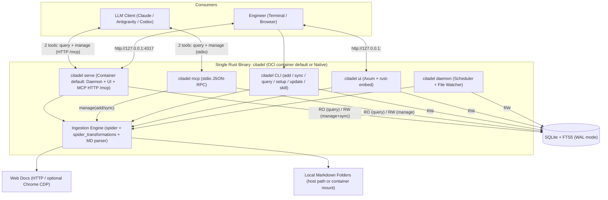

# Technical Specification: Citadel

> **Status:** Draft v1  
> **Stage:** `Idea -> PRD -> [TechSpec (SPEC.md)] -> AgentRules -> AtomicTasks -> Prototype -> LLMCode`  
> **Upstream:** [PRD.md](./PRD.md)

---

## 1. Architecture Overview

**Citadel** is built as a **single native Rust binary** (`citadel`) backed by a local **SQLite (WAL mode) + FTS5** database.
- **Default deployment (OCI container):** Runs `citadel serve` inside a minimal OCI Linux container built from the `Dockerfile` and managed by Docker by default, or by Apple's **`container`** CLI (`https://github.com/apple/container`) with `RUNTIME=container` (ADR-0003), combining the background scheduler/watcher, embedded Web UI (`/`), REST API (`/api/*`), and MCP Streamable HTTP endpoint (`/mcp`) in one low-resource process (`serve` and the container are not yet measured; the native macOS `daemon` uses ~5 MB idle with an empty vault, ~25–35 MB idle after Syncs, and up to ~120 MB briefly during a 500-page Sync; see [resource-usage.md](./resource-usage.md)).
- **Native installation (macOS/Linux):** Install the same binary locally; `cli`, `mcp` (`stdio`), `ui`, and `daemon` share `vault.db` directly in WAL mode so `mcp` and `cli` work even when the daemon is stopped.



### Data & Config Paths
Resolved via `CITADEL_HOME` env var, `--data-dir` flag, or OS defaults (`directories` crate):
- **Container default:** `/data` (mounted persistent volume, `CITADEL_HOME=/data`; optional host Markdown folders mounted read-only under `/sources/...`).
- **macOS (native):** `~/Library/Application Support/com.citadel.citadel/` (`directories` bundle-id layout; XDG variables are ignored on macOS)
- **Linux (native):** `${XDG_DATA_HOME:-~/.local/share}/citadel/`
- **Files inside data dir:**
  - `vault.db` (+ `vault.db-wal`, `vault.db-shm`) — primary SQLite database
  - `daemon.pid` — active daemon PID lockfile
  - `daemon.json` — written (best effort; a failure is logged, not fatal) while the daemon holds the lock: `pid`, `version`, `exe`, `exe_mtime_secs`, `started_at`; read by `citadel doctor`, removed with `daemon.pid`
  - `daemon.log` — rotating daemon log
  - `update-check.json` — cached latest-release metadata (`checked_at`, `latest_version`, `release_url`, 24h TTL)
- **`CITADEL_ALLOW_PRIVATE_ORIGINS`:** `1` or `true` allows web Sources on Private origins (intranet docs, `localhost`); off by default.
- **`CITADEL_NO_UPDATE_CHECK`:** `1` or `true` disables automatic background update checks.
- **`CITADEL_CHROME_NO_SANDBOX`:** `1` or `true` launches the `render_js` Chrome without its sandbox natively (explicit opt-out for hosts where the sandbox cannot start, e.g. AppArmor-restricted user namespaces on Ubuntu 23.10+, or root); off by default. Containers always run Chrome with `--no-sandbox`.

---

## 2. Rust Crate Stack & Module Layout

### Core Dependencies
| Concern | Crate | Rationale |
|---|---|---|
| Async runtime | `tokio` (multi-thread, `rt-multi-thread`, `macros`, `signal`, `time`) | Required by `spider` and `axum` |
| CLI | `clap` (derive) | Type-safe subcommands, help, shell completions |
| Storage & FTS | `rusqlite` (`bundled`, `modern_sqlite`, `hooks`, `functions`) | Zero system SQLite dependency, FTS5 + authorizer + progress handler |
| Web crawling | `spider` + `spider_transformations` (MIT) | Async crawler, sitemap, politeness, readability + HTML-to-MD, `chrome` feature (default) |
| Markdown parsing | `pulldown-cmark` | Fast AST heading splitter for `sections` |
| Hashing & Diffing | `sha2`, `similar` | Normalized SHA-256 content hashes + unified diffs |
| File watching | `notify` + `notify-debouncer-mini` | Cross-platform FS events for local Markdown folders |
| MCP server | `rmcp` (or lightweight custom JSON-RPC 2.0 over `tokio::io::stdin/stdout`) | Strict stdio transport; zero stdout pollution |
| Embedded Web UI | `axum`, `rust-embed`, `mime_guess`, `open` | Single-binary local web server, ~10 MB RAM |
| Interactive setup & config merge | `cliclack`, `toml_edit`, `serde_json` | Guided CLI setup wizard + format/comment-preserving TOML (Codex) and JSON (Claude/Antigravity) MCP config merging |
| Self-update & version check | `reqwest` (existing), `semver`, `flate2`, `tar`, `sha2` (existing) | GitHub Releases version check, tarball extraction, and SHA-256 verification |
| Logging & Errors | `tracing`, `tracing-subscriber`, `thiserror`, `anyhow` | Structured logs to `stderr` (never `stdout` in MCP mode) |

### Cargo Feature Flags
- `default = ["chrome"]`; `chrome = ["spider/chrome", "dep:tempfile"]` — per-source headless Chrome/CDP rendering for JS-built pages. Lite builds use `--no-default-features` (`make install-lite`, `make build-lite`).

### Source Layout
```text
src/
  main.rs            # CLI entrypoint & command dispatch
  config.rs          # Paths, env overrides, defaults
  db/
    mod.rs           # Connection pool/open helpers, WAL pragmas, migrations
    schema.sql       # Versioned SQLite DDL
    readonly.rs      # Read-only MCP query executor + authorizer + limits
  sources/
    mod.rs           # Source lifecycle: async-only `SourceLifecycle` (add, update, remove, sync,
                     # sync_all); registration, slugging, origin classification, limits.
                     # Every entry point (CLI, MCP, UI, daemon) goes through it.
  ingest/
    mod.rs           # Source/Page record types, row mappers, read views (list/show)
    web.rs           # spider + spider_transformations integration
    local.rs         # Local Markdown folder walker + frontmatter stripping
    normalize.rs     # Noise stripping, SHA-256 hashing, unified diff generation
    sections.rs      # pulldown-cmark heading splitter (H1-H3 breadcrumbs)
  mcp/
    mod.rs           # stdio JSON-RPC server + `query` and `manage` tool handlers
    prompt.rs        # Schema & SQL recipe description embedded in tool specs
  daemon/
    mod.rs           # Periodic refresh scheduler + notify folder watcher
    service.rs       # launchd plist & systemd --user unit generator
  ui/
    mod.rs           # Axum router, localhost binding, Origin guard
    api.rs           # JSON REST endpoints for the UI
    assets/          # Static HTML/CSS/JS embedded via rust-embed
  skill/
    mod.rs           # Skill path resolver + installer (CWD, --path, --global)
    SKILL.md         # Embedded static router skill (include_str!)
  setup/
    mod.rs           # Interactive `citadel setup` wizard + non-interactive runner
    agents.rs        # Per-agent skill & MCP config path resolvers (claude, agy, codex)
    merge.rs         # Safe JSON (`serde_json`) & TOML (`toml_edit`) MCP config mergers
  update/
    mod.rs           # `citadel update` GitHub Releases downloader, SHA-256 verifier, atomic swap
    check.rs         # Cached 24h update-check.json reader + non-blocking background refresher
```

---

## 3. Database Schema & Read-Only Query Safety

### Pragmas (Applied on Every Connection)
- **Read-Write connections:** `PRAGMA journal_mode = WAL; PRAGMA synchronous = NORMAL; PRAGMA foreign_keys = ON; PRAGMA busy_timeout = 5000;`
- **MCP Read-Only connections:** opened with `OpenFlags::SQLITE_OPEN_READ_ONLY | SQLITE_OPEN_NO_MUTEX`, plus `PRAGMA query_only = ON; PRAGMA busy_timeout = 3000;`.

### SQLite DDL (`src/db/schema.sql`)
```sql
CREATE TABLE IF NOT EXISTS sources (
    id                    INTEGER PRIMARY KEY,
    name                  TEXT NOT NULL UNIQUE,           -- slug, e.g. 'hex-docs'
    kind                  TEXT NOT NULL CHECK (kind IN ('web', 'local')),
    origin                TEXT NOT NULL UNIQUE,           -- root URL or absolute dir path
    tags                  TEXT NOT NULL DEFAULT '[]',     -- JSON array of strings
    include_patterns      TEXT NOT NULL DEFAULT '[]',     -- JSON glob/prefix list
    exclude_patterns      TEXT NOT NULL DEFAULT '[]',     -- JSON glob/prefix list
    max_pages             INTEGER NOT NULL DEFAULT 500,
    max_depth             INTEGER NOT NULL DEFAULT 5,
    render_js             INTEGER NOT NULL DEFAULT 0,     -- 1 = use headless Chrome if enabled
    refresh_interval_secs INTEGER NOT NULL DEFAULT 86400, -- 0 = manual only
    status                TEXT NOT NULL DEFAULT 'idle'
                          CHECK (status IN ('idle', 'syncing', 'ok', 'error')),
    last_synced_at        TEXT,                           -- ISO-8601 UTC
    last_error            TEXT,
    created_at            TEXT NOT NULL DEFAULT (strftime('%Y-%m-%dT%H:%M:%SZ', 'now'))
);

CREATE TABLE IF NOT EXISTS pages (
    id               INTEGER PRIMARY KEY,
    source_id        INTEGER NOT NULL REFERENCES sources(id) ON DELETE CASCADE,
    uri              TEXT NOT NULL,                       -- canonical URL or relative file path
    title            TEXT NOT NULL DEFAULT '',
    content_md       TEXT NOT NULL,                       -- clean Markdown body
    content_hash     TEXT NOT NULL,                       -- SHA-256 of normalized content
    word_count       INTEGER NOT NULL DEFAULT 0,
    etag             TEXT,                                -- HTTP ETag for conditional GET
    last_modified    TEXT,                                -- HTTP Last-Modified header
    status           TEXT NOT NULL DEFAULT 'active'
                     CHECK (status IN ('active', 'stale', 'error')),
    http_status      INTEGER,
    error_message    TEXT,
    first_seen_at    TEXT NOT NULL DEFAULT (strftime('%Y-%m-%dT%H:%M:%SZ', 'now')),
    last_checked_at  TEXT NOT NULL DEFAULT (strftime('%Y-%m-%dT%H:%M:%SZ', 'now')),
    last_changed_at  TEXT NOT NULL DEFAULT (strftime('%Y-%m-%dT%H:%M:%SZ', 'now')),
    UNIQUE (source_id, uri)
);

CREATE TABLE IF NOT EXISTS sections (
    id            INTEGER PRIMARY KEY,
    page_id       INTEGER NOT NULL REFERENCES pages(id) ON DELETE CASCADE,
    source_id     INTEGER NOT NULL REFERENCES sources(id) ON DELETE CASCADE,
    ordinal       INTEGER NOT NULL,                       -- 0-based order in page
    heading       TEXT NOT NULL DEFAULT '',               -- section heading text
    heading_path  TEXT NOT NULL DEFAULT '',               -- breadcrumb: 'Ingestion > CDC'
    level         INTEGER NOT NULL DEFAULT 0,             -- 0=intro, 1=H1, 2=H2, 3=H3
    content_md    TEXT NOT NULL,
    word_count    INTEGER NOT NULL DEFAULT 0
);

-- Keeps the most recent diff per page (upserted on content change)
CREATE TABLE IF NOT EXISTS page_revisions (
    page_id        INTEGER PRIMARY KEY REFERENCES pages(id) ON DELETE CASCADE,
    previous_hash  TEXT NOT NULL,
    new_hash       TEXT NOT NULL,
    unified_diff   TEXT NOT NULL,                         -- capped at 64 KB
    changed_at     TEXT NOT NULL DEFAULT (strftime('%Y-%m-%dT%H:%M:%SZ', 'now'))
);

CREATE TABLE IF NOT EXISTS sync_runs (
    id              INTEGER PRIMARY KEY,
    source_id       INTEGER NOT NULL REFERENCES sources(id) ON DELETE CASCADE,
    started_at      TEXT NOT NULL,
    finished_at     TEXT,
    status          TEXT NOT NULL CHECK (status IN ('running', 'ok', 'error')),
    pages_added     INTEGER NOT NULL DEFAULT 0,
    pages_updated   INTEGER NOT NULL DEFAULT 0,
    pages_unchanged INTEGER NOT NULL DEFAULT 0,
    pages_stale     INTEGER NOT NULL DEFAULT 0,
    pages_failed    INTEGER NOT NULL DEFAULT 0,
    error_message   TEXT
);

-- Sync claims (ADR-0001): at most one Sync per Source across every process.
CREATE TABLE IF NOT EXISTS sync_claims (
    source_id      INTEGER PRIMARY KEY REFERENCES sources(id) ON DELETE CASCADE,
    pid            INTEGER NOT NULL,                      -- holder process id
    instance_token TEXT NOT NULL,                         -- random per holder process start
    claimed_at     TEXT NOT NULL                          -- ISO-8601 UTC
);

-- External-content FTS5 tables (porter + unicode61 tokenization)
CREATE VIRTUAL TABLE IF NOT EXISTS pages_fts USING fts5(
    title, content_md,
    content='pages', content_rowid='id',
    tokenize='porter unicode61'
);

CREATE VIRTUAL TABLE IF NOT EXISTS sections_fts USING fts5(
    heading_path, content_md,
    content='sections', content_rowid='id',
    tokenize='porter unicode61'
);

CREATE INDEX IF NOT EXISTS idx_pages_source_status ON pages(source_id, status);
CREATE INDEX IF NOT EXISTS idx_sections_page ON sections(page_id, ordinal);
CREATE INDEX IF NOT EXISTS idx_sections_source ON sections(source_id);
CREATE INDEX IF NOT EXISTS idx_sync_runs_source ON sync_runs(source_id, started_at DESC);
```

*FTS5 synchronization* is maintained via SQLite `AFTER INSERT`, `AFTER DELETE`, and `AFTER UPDATE` triggers on `pages` and `sections` so FTS indexes never drift from base tables.

### Convenience Views (for Concise LLM Queries)
- `v_sources`: joins `sources` with live counts of `active_pages`, `stale_pages`, `error_pages`, and `total_words`.
- `v_recent_changes`: joins `page_revisions`, `pages`, and `sources` ordered by `changed_at DESC`.

### Read-Only MCP Safety Guardrails (`src/db/readonly.rs`)
Every SQL statement executed through MCP passes **four layers of defense**:
1. **OS/SQLite read-only mode:** `SQLITE_OPEN_READ_ONLY` + `PRAGMA query_only = ON`.
2. **SQLite Authorizer callback:** Explicitly allows only `SQLITE_SELECT`, `SQLITE_READ`, `SQLITE_FUNCTION` (safe built-ins + FTS5 `bm25`/`snippet`/`highlight`), and denies `INSERT`, `UPDATE`, `DELETE`, `DROP`, `ALTER`, `ATTACH`, `DETACH`, `PRAGMA`, `VACUUM`, and `load_extension`.
3. **Single-statement enforcement:** Rejects multi-statement strings (`;` followed by non-whitespace tokens).
4. **Resource caps:**
   - **Timeout:** `progress_handler` aborts queries exceeding `5000 ms`.
   - **Row cap:** Default `limit = 50`, hard max `200` rows (enforced by wrapping or truncating iteration + setting `truncated: true`).
   - **Payload cap:** Hard cap of `100 KB` serialized JSON per tool response (with a clear truncation hint instructing the LLM to select `sections` or `snippet()` instead of full `pages.content_md`).

---

## 4. Ingestion, Normalization & Diff Pipeline

### 4.1 Web Ingestion (`spider` + `spider_transformations`)
1. **Discovery:** Initialize `spider::website::Website` on `source.origin` with:
   - Scope restricted to `origin` host + path prefix (unless overridden by `include_patterns`).
   - `respect_robots_txt(true)`, configurable `max_pages` and `max_depth`, polite concurrency cap (default 4 concurrent requests, 100 ms delay).
   - **robots.txt today:** spider parses `robots.txt`. Its parser ends a rule group at an empty line, so on sites such as `docs.aws.amazon.com` the `Disallow` and `Crawl-delay` lines after one are ignored. When the parser keeps a `Crawl-delay`, it replaces Citadel's 100 ms delay (`Crawl-delay: 0` removes it).
   - **Discovery and later crawls:** Citadel reads `sitemap.xml` and `llms.txt` itself (`discover_seed_urls`). After the first crawl, it starts one new crawler per discovered URL that no earlier crawl collected, one after another, each with the remaining page budget. The crawl code hands every page each crawl delivers to `CollectedPages` (`src/ingest/web/collected.rs`). That module sizes each later crawl, decides what every collected page becomes, whether the Sync is cut off and what happens to unvisited pages, and keeps every page count on the summary line. It does no I/O; the crawl code only crawls and measures time.
   - **Page budget:** `max_pages` counts every page spider admits, including pages that redirect out of the Source and are not stored.
   - **Requests with no `fetch` log line:** Citadel's discovery requests, spider's own sitemap pass (static crawls only, no delay), its re-fetch of a crawler's start URL after a 404 sitemap probe, redirect hops and `robots.txt`.
   - If `source.render_js == 1` and the binary has the `chrome` feature, launch a private headless Chrome for this crawl (temporary profile, `src/ingest/browser.rs`) — or use `CHROME_URL` when set — and hand it to `spider` via `with_chrome_connection`; wait for idle network + idle DOM (10 s cap per page) before reading links, then run a page script that copies open shadow-DOM content into the page and removes large link-only navigation lists. Chrome keeps its sandbox natively unless `CITADEL_CHROME_NO_SANDBOX=1`; inside a container it runs with `--no-sandbox`. No reachable browser fails the Sync with an actionable error; a sandbox that cannot start (`No usable sandbox`, root) fails it with an error that names the fixes instead (AppArmor profile, `CHROME_URL`, the opt-out). spider's own sitemap pass is disabled for these crawls (Citadel seeds from sitemaps itself); a crawl in which no page finishes for 5 minutes is stopped and fails the Sync with previous pages kept; and a browser-reported HTTP 4xx is recorded only when a direct request to the server agrees (checked after each rendered crawl, before its pages are handed over). Without the `chrome` feature, crawl over static HTTP and return a clear warning.
2. **Extraction:** Transform raw HTML with `spider_transformations::transformation::content` (`ReturnFormat::Markdown`, `readability: true`, stripping `<nav>`, `<footer>`, `<script>`, `<style>`).
   - **One Page per document** (`pair_documents`, after every crawl, so seed order does not matter). Link tags are read with `lol_html`, which accepts minified HTML.
     - **Effective URL:** a page is placed at the URL its redirects ended at (`effective_url`, spider's `get_url_final`), not at the URL that was requested. When the two differ and the destination fetched cleanly, the requested URL gets a `Retired` result, so a row an earlier Sync stored there goes stale; when the destination failed, that row is marked `error` instead (no row is inserted). These extra results are left out of the cut-off count, which counts one result per page. spider does not follow a redirect to a loopback or private address, so for those Sources the redirect is recorded as a failed page.
     - **URL alias:** pages whose effective URLs share a `document_key` (the dedup key, which also removes a trailing `/index`, `/index.html` or `/index.htm`) are one document: `/p`, `/p/` and `/p/index.html`. The query string is kept. The stored copy does not depend on arrival order: a cleanly fetched page beats a failed one, then the URL a member's `rel=canonical` names, then the shortest URL, then the lowest. Later crawls skip seeds by `document_key`, including the destinations of redirects already followed, but keep alias pages they fetch so their old rows are retired.
     - **Markdown twin:** the Markdown copy of a cleanly fetched HTML page `X` — the target of its `<link rel="alternate" type="text/markdown">`, else `X.md`, else `X/index.md` — when that URL was collected and is Markdown (`is_markdown_response`). The document is stored once, at `X`'s URI, with the twin's Markdown as content (its frontmatter `title` wins) and `X`'s `etag`/`last_modified`. When the twin failed, `X`'s converted HTML is stored and the twin records no error. When `X` failed, nothing is paired. A `.md` URL with no collected HTML page is stored at its own URI.
     - **Canonical duplicate:** an HTML page whose `<link rel="canonical">` names another collected, cleanly fetched page that differs only by its query string (`/guide?version=2` -> `/guide`); the trailing slash and `/index` variants are already merged as URL aliases. A canonical to another path never merges pages.
     - Each merged copy yields a `Retired` result: its stored row goes `stale` (deleted with `--prune`) even in a cut-off Sync, because the Sync visited it. No row is inserted for it.
     - Later crawls size their remaining budget by documents, counting an `X`/`X.md` pair once (`count_scoped_documents`). The cut-off rule still counts every storable URL and every result, `Retired` included (`count_scoped_urls`), because spider's limit counts every fetch; erring toward cut-off keeps unvisited pages.
3. **Stale Detection:** Track the set of URIs seen during a full sync run. Any previously `active` page for that source **not** seen in the completed crawl is marked `status = 'stale'` (never silently deleted). Pages returning 4xx/5xx are marked `status = 'error'` with `http_status` and `error_message` while preserving their last good `content_md`.
   - **Cut-off rule** (`is_cut_off`): a Sync is **cut off** when its first crawl used up `max_pages` (pages delivered plus pages lost by the receiving task), or when the distinct storable pages it collected, or its results (stored, failed, or merged copies, one per page: a redirect's extra result for its requested URL is left out), reach `max_pages`, whether or not those pages were stored. Without `--prune`, a cut-off Sync leaves unvisited pages as they were; a complete Sync marks them stale. With `--prune`, missing pages are deleted either way.
4. **Sync summary line:** every web Sync whose Origin is a valid URL logs one `web_sync_summary` line at `info` when it ends, whether it succeeds or fails (`sync_web_source_with_accounting`). Text values are quoted. It carries, in order: `source`, `origin`, `ok`, `max_pages`, `cut_off`, `delay_ms` (the delay spider reports after the first crawl), `pages_received` (every page any crawler delivered), `results_stored`, `results_failed`, `lost_by_listener` (pages missed because the receiving task fell behind), the pages that got no result, each under the first reason it meets (`unparsable_url`, `already_collected`, `redirected_out_of_scope`, `url_not_storable`, `duplicate_result`, `markdown_twin`, `canonical_duplicate`, `url_alias`, `binary_file`), `later_crawls_started`, and the step durations `discovery_ms`, `first_crawl_ms`, `later_crawls_ms`, `conversion_ms`, `write_ms` (`-` for a step the Sync never reached). When every crawl finishes, `pages_received` equals the results plus the nine drop counts; a Sync whose crawl failed can have fewer, because its pages are never converted. A step that ran and failed still has its duration.
5. **Budget warning** (`budget_warning`): a cut-off Sync whose pages redirected outside the Source number at least 5 and more than 10 % of the pages received adds one warning to its Sync summary. It gives the count, up to three requested URLs, says they count against `max_pages`, and suggests raising `max_pages` or excluding that section. The CLI prints it; the UI and MCP receive it in the Sync summary. The thresholds are open ([design](./egm/2026-11-24-sync-measurement-one-request-per-url-design.md) Q2).

**Planned: robots.txt** (later design, not yet drafted; decided in [concepts_brief.md](./egm/concepts_brief.md), "Direction from the author"):
- Obey `Disallow` with a parser that skips empty lines (candidate: `texting_robots`, used by Firecrawl). Apply it to the Origin, the final URL after redirects, followed links, and sitemap and `llms.txt` URLs.
- Do not apply `Crawl-delay`; log it when a site sets one, as Firecrawl and crawl4ai do.
- Rollout risk: pages under a newly obeyed `Disallow` rule become stale.

### 4.2 Local Markdown Folder Ingestion
1. Recursively walk `source.origin` for `*.md` and `*.markdown` files (ignoring `.git`, `node_modules`, hidden dirs).
2. Store relative path (e.g., `chapters/ch05-ingestion.md`) as `uri`.
3. Extract `title` from YAML frontmatter `title:` if present, else first H1 heading, else filename stem.
4. Files removed from disk are marked `status = 'stale'` on sync (or deleted if `--prune` is explicitly passed).

### 4.3 Normalization & Meaningful Diffing (`src/ingest/normalize.rs`)
To eliminate false-positive diffs (such as volatile `created:` / `updated:` / `crawled_at:` frontmatter timestamps):
1. Strip YAML frontmatter volatile keys (`created`, `updated`, `date`, `crawled_at`, `fetched_at`, `last_modified`) before hashing.
2. Normalize line endings (`\r\n` -> `\n`), trim trailing whitespace per line, and collapse 3+ blank lines to 2.
3. Compute `content_hash = sha256(normalized_md)`.
4. Compare against existing `pages.content_hash`:
   - **Match:** Update `last_checked_at` only; increment `pages_unchanged`.
   - **Differ:** Generate a unified diff (`similar::TextDiff::from_lines`) capped at 64 KB, upsert `page_revisions`, update `pages.content_md`, `content_hash`, `last_changed_at`, and re-split `sections` inside a single SQLite transaction.

### 4.4 Heading-Based Section Splitting (`src/ingest/sections.rs`)
- Parse `content_md` with `pulldown-cmark`.
- Split on headings `H1`, `H2`, and `H3`, maintaining a heading stack to build `heading_path` (e.g., `Data Modeling > Kimball > SCD Types`).
- Content before the first heading becomes `ordinal = 0`, `level = 0`, `heading = '(Intro)'`.
- Sections exceeding ~2,000 words without subheadings are left intact in v1 (LLM can use `substr()` or `snippet()`).

---

## 5. MCP Server Specification (`citadel mcp` & `/mcp`)

### Transports
- **Streamable HTTP (Container default):** Mounted at `POST/GET /mcp` on `citadel serve` (default `http://127.0.0.1:4317/mcp` on the host). Lets any MCP client connect directly to the running container without spawning extra processes.
- **Stdio (Native & container exec):** `citadel mcp` speaks newline-delimited JSON-RPC 2.0 on `stdin`/`stdout` (also usable via `docker exec -i citadel citadel mcp`, or `container exec -i …` with Apple's runtime).
- **Logging rule:** In `stdio` mode, all logs MUST go to `stderr` or file—never `stdout`.

### Tool Surface (2 Minimal Composable Tools)

#### 1. `query` (Strictly Read-Only Data Retrieval)
- **Purpose:** Discover sources, search `pages_fts`/`sections_fts`, inspect diffs/staleness, and retrieve exact sections in one SQL call.
- **Connection:** Dedicated `SQLITE_OPEN_READ_ONLY` + authorizer connection (cannot mutate DB).
- **Input schema:**
```json
{
  "type": "object",
  "properties": {
    "sql": {
      "type": "string",
      "description": "Single read-only SQLite SELECT statement against sources, v_sources, pages, sections, pages_fts, sections_fts, page_revisions, or v_recent_changes."
    },
    "limit": {
      "type": "integer",
      "minimum": 1,
      "maximum": 200,
      "default": 50,
      "description": "Maximum rows to return (default 50, max 200)."
    }
  },
  "required": ["sql"]
}
```
- **Tool description:** Concisely embeds table/column names, FTS5 syntax (`sections_fts MATCH '...'`, `bm25(sections_fts)`, `snippet(...)`), and a 2-step pattern: (1) search `v_sources` or `sections_fts` for snippets/IDs, (2) fetch exact `sections.content_md` by `id`.
- **Success response:**
```json
{
  "columns": ["source", "uri", "heading_path", "snippet", "last_changed_at"],
  "rows": [ ... ],
  "row_count": 5,
  "truncated": false,
  "elapsed_ms": 4
}
```

#### 2. `manage` (Composable Vault Management)
- **Purpose:** Add, sync, update, or remove sources directly from the LLM without exposing one tool per operation.
- **Connection:** Uses the standard RW SQLite connection and the shared `ingest` module.
- **Input schema:**
```json
{
  "type": "object",
  "properties": {
    "action": {
      "type": "string",
      "enum": ["add", "sync", "update", "remove"],
      "description": "Vault management operation to perform."
    },
    "origin": {
      "type": "string",
      "description": "Required for 'add': http(s):// root URL or absolute local Markdown folder path."
    },
    "name": {
      "type": "string",
      "description": "Source slug. Optional for 'add' (auto-derived if omitted); required for 'update'/'remove'; optional for 'sync' (syncs all if omitted)."
    },
    "tags": {
      "type": "array",
      "items": { "type": "string" }
    },
    "refresh_interval_secs": {
      "type": "integer",
      "minimum": 0,
      "description": "0 = manual only."
    },
    "max_pages": { "type": "integer", "minimum": 1, "maximum": 5000 },
    "max_depth": { "type": "integer", "minimum": 1, "maximum": 20 },
    "include_patterns": { "type": "array", "items": { "type": "string" } },
    "exclude_patterns": { "type": "array", "items": { "type": "string" } },
    "render_js": { "type": "boolean" },
    "sync_now": {
      "type": "boolean",
      "default": true,
      "description": "For 'add': whether to run initial ingestion immediately (default true)."
    }
  },
  "required": ["action"]
}
```
- **Validation & Safety Guardrails for `manage`:**
  - `origin` URLs must use `http://` or `https://` and reject Private origins (loopback, RFC1918, link-local such as `169.254.169.254`, CGNAT, multicast, `localhost`/`*.local`) unless `CITADEL_ALLOW_PRIVATE_ORIGINS=1`. The same rule (`src/sources/origin.rs`) applies to every entry point: CLI `add`, UI `POST /api/sources`, MCP `manage add`, and every Sync, including the scheduler.
  - Local `origin` paths must resolve to an existing directory (`canonicalize`) and only ingest `*.md` / `*.markdown` files.
  - `remove` returns the deleted source name and page count; `add`/`sync` returns structured sync summary (`pages_added`, `pages_updated`, `pages_unchanged`, `pages_stale`, `pages_failed`).
  - `sync` without `name` syncs every Source independently and also returns `results`: one entry per Source with `outcome` `synced` (plus `summary`), `already_syncing`, or `error` (plus `error`). A failed Source never stops the others.
  - A Source whose Sync claim is held elsewhere is not synced or removed: `sync`/`remove` return `outcome: "already_syncing"` with `isError: false`.
  - Every failed Sync, from any entry point, records an error Sync run and sets the Source's `status = 'error'` and `last_error`.
- **Error response (both tools):** `isError: true` with an actionable error message (e.g., `"Write operations are disabled on MCP query tool"`, `"no such column: ..."`, or `"origin must be an http(s) URL or existing directory"`), enabling immediate LLM self-correction.

---

## 6. CLI Specification

```text
citadel
  add <url-or-path> [--name <slug>] [--tags <a,b>] [--interval <duration>]
                    [--max-pages <n>] [--max-depth <n>] [--include <pat>...]
                    [--exclude <pat>...] [--render-js] [--no-sync]
  list [--json]
  show <name>                     # source details, sync history, stale/error pages
  sync [<name>] [--all] [--prune] # manual sync; --all reports every source, exits 1 if any failed
  rm <name> [--yes]               # remove source and cascade stored pages
                                  # add/sync refuse Private origins (loopback, RFC1918,
                                  # link-local, localhost) unless CITADEL_ALLOW_PRIVATE_ORIGINS=1
  query "<sql>" [--limit <n>] [--format table|json|csv]
  serve [--bind 0.0.0.0:4317]     # all-in-one server: daemon + Web UI + MCP HTTP (/mcp) (Container default)
  mcp                             # start stdio MCP server (native / container exec)
  ui [--port <port>] [--no-open]  # launch embedded local Web UI (native)
  daemon
    start [--foreground]
    stop
    status
    install                       # write & load launchd (macOS) / systemd --user (Linux)
    uninstall
  skill
    install [--path <dir>] [--global] [--target <agents|claude|copilot|opencode|all>] [--force]
  setup                           # interactive wizard to configure skill + MCP for claude, agy, codex
        [--agent <claude|agy|codex>...] [--scope <local|global>]
        [--transport <stdio|http>] [--url <http-mcp-url>]
        [--only <skill|mcp|both>] [--force] [--yes]
  update [--check] [--yes]        # check for or install latest GitHub Release binary
  doctor [--json]                 # read-only health report; exits 1 if any check fails
```

### Health Report (`citadel doctor`)
One read-only report in four sections. It never writes a file, creates the data directory, opens `vault.db` or starts a process, and it skips the automatic update notice. Design: [doctor-command](./superpowers/specs/2026-11-25-doctor-command-design.md).
- **Version:** CLI against the latest release (live check with a 3 s timeout, else `update-check.json`; `CITADEL_NO_UPDATE_CHECK=1` uses the cache only); the daemon's version and binary from `daemon.json` against the CLI; the `serve` version (MCP `initialize`) against the CLI.
- **Running:** daemon state, OS service (installed, loaded, data dir and binary match the CLI), count of `daemon`/`serve` processes, and whether `serve` answers on `127.0.0.1:4317`. Inside a container it skips the daemon, service and process rows.
- **Setup:** for Claude Code, Antigravity and Codex, in local (current directory) and global (home) scope: the skill (present, dangling, outdated) and the `citadel` MCP entry (stdio command resolves, HTTP URL answers). It runs `--version` only on a stdio command that is the bare name `citadel` found in an absolute `PATH` directory, or an absolute path named `citadel`; any other resolved command is `·` "version not checked", a relative path is `·` "relative command, not checked", and neither is run. Local scope is skipped when the current directory is the home directory.
- **Data:** the data directory path, marked `(not created yet)` when absent.

Rows are marked `✓` ok, `·` info, `!` warning, `✗` fail; each `!`/`✗` row names the command that fixes it. `--json` prints `{"checks": [{section, name, status, detail, hint}]}`. Exit code is `1` only when a check fails; warnings exit `0`.

### `skill install` Path Resolution
The embedded static router `SKILL.md` (`src/skill/SKILL.md`) documents the SQLite schema, FTS5 query recipes, and grounding rules.
1. **Default (no flags):** Installs into `./.agents/skills/citadel/SKILL.md` in the current working directory.
2. **`--path <dir>`:** Installs into `<dir>/citadel/SKILL.md` (creating parent directories if needed).
3. **`--global`:**
   - Default `--target all` (or `agents`): writes the canonical copy to `~/.agents/skills/citadel/SKILL.md` and creates a symlink at `~/.claude/skills/citadel -> ~/.agents/skills/citadel` (if `~/.claude` exists or `--target claude` is requested).
   - Additional `--target` values (`copilot` -> `~/.copilot/skills/citadel`, `opencode` -> `~/.config/opencode/skills/citadel`) symlink to the same canonical `~/.agents/skills/citadel` directory.
4. **Safety:** Refuses to overwrite an existing `SKILL.md` unless `--force` is passed.

### Interactive Setup Wizard (`citadel setup`)
Running `citadel setup` in an interactive TTY launches a guided `cliclack` wizard; passing any setup flag (`--agent`, `--scope`, `--transport`, `--only`, `--force`, `--yes`) runs non-interactively for scripts/CI.

#### Wizard Flow
1. **Select target agent(s)** (multi-select): **Claude Code (`claude`)**, **Antigravity (`agy`)**, **Codex (`codex`)**.
2. **Select scope**: **Local** (current working directory) or **Global** (user home config).
3. **Select components**: **Skill + MCP** (default), Skill only, or MCP only.
4. **Confirm MCP transport** (when MCP is selected): auto-detects whether a `citadel serve` HTTP endpoint (`http://127.0.0.1:4317/mcp`) answers a JSON-RPC `ping` POST and defaults accordingly (`http` if it does, otherwise `stdio` using `citadel mcp`); user can switch between `stdio` and `http` (or override via `--transport` / `--url`).
5. **Preview & confirm**: Prints the exact list of files to create/update (flagging any existing `citadel` entries) before writing.

#### Per-Agent Target Paths & Config Formats
| Agent | Scope | Skill Path | MCP Config Path & Entry |
|---|---|---|---|
| **Claude Code** (`claude`) | Local | `./.claude/skills/citadel/SKILL.md` | `./.mcp.json` (`mcpServers.citadel`, JSON) |
| **Claude Code** (`claude`) | Global | `~/.claude/skills/citadel` *(symlink -> `~/.agents/skills/citadel`)* | `~/.claude.json` (`mcpServers.citadel`, JSON) |
| **Antigravity** (`agy`) | Local | `./.agents/skills/citadel/SKILL.md` | `./.agents/plugins/citadel/plugin.json` + `./.agents/plugins/citadel/mcp_config.json` (`mcpServers.citadel`, JSON) |
| **Antigravity** (`agy`) | Global | `~/.gemini/config/skills/citadel` *(symlink -> `~/.agents/skills/citadel`)* | `~/.gemini/config/mcp_config.json` (`mcpServers.citadel`, JSON) |
| **Codex** (`codex`) | Local | `./.agents/skills/citadel/SKILL.md` | `./.codex/config.toml` (`[mcp_servers.citadel]`, TOML) |
| **Codex** (`codex`) | Global | `~/.agents/skills/citadel/SKILL.md` | `~/.codex/config.toml` (`[mcp_servers.citadel]`, TOML) |

- **MCP entry shape:**
  - `stdio`: `{ "command": "citadel", "args": ["mcp"] }` (JSON) / `command = "citadel"`, `args = ["mcp"]` (TOML).
  - `http`: `{ "url": "http://127.0.0.1:4317/mcp" }` (JSON, using `"type": "http"` for Claude Code where required) / `url = "http://127.0.0.1:4317/mcp"` (TOML).
- **Safe merging & overwrite rules:**
  - JSON configs are parsed and updated via `serde_json` (`mcpServers["citadel"] = ...`), preserving all unrelated keys and other MCP servers.
  - TOML configs (`config.toml`) are edited via `toml_edit`, preserving existing comments, formatting, and other `[mcp_servers.*]` tables.
  - When a `citadel` skill or MCP entry already exists, interactive mode asks for confirmation before overwriting; non-interactive mode refuses to overwrite unless `--force` is passed.

### Self-Update & Automatic Update Awareness (`citadel update`)

#### Release Artifacts (GitHub Releases)
- Published on GitHub Releases as versioned tarballs (`citadel-v<semver>-<target>.tar.gz` for `aarch64-apple-darwin`, `x86_64-apple-darwin`, `aarch64-unknown-linux-gnu`, `x86_64-unknown-linux-gnu`) alongside a `checksums.sha256` manifest (`sha256sum` format). Each tarball holds the `citadel` binary at its root.
- Produced by `.github/workflows/release.yml` when a `vX.Y.Z` tag is pushed; the tag must equal `v` + the `Cargo.toml` version or the run fails before building (see §10). `tests/ci_workflows.rs` pins the workflow to this contract.
- Linux binaries are built on Ubuntu 22.04 and need glibc 2.35+. No Windows artifact is published.

#### `citadel update` Execution
1. **Container detection:** If running inside an OCI container (`/.dockerenv`, `/run/.containerenv`, or `CITADEL_CONTAINER=1`; Apple `container` creates neither marker file, so `make run` and the documented `container run` command set `CITADEL_CONTAINER=1`), do **not** mutate the container binary. Instead print the current and latest version (a short live check, falling back to `update-check.json`) and, unless already up to date, the exact steps to check out the release source (`git fetch --tags && git checkout vX.Y.Z`), rebuild the image and recreate the container with Apple `container` (or `make build && make run`).
2. **Version check:** Query the GitHub Releases latest endpoint and compare with `env!("CARGO_PKG_VERSION")` using `semver`. With `--check`, print status and exit without modifying the binary.
3. **Atomic native upgrade:** Download the platform tarball and `checksums.sha256` into a temp file in the executable's directory, verify the SHA-256 digest before extracting, atomically replace the running binary (preserving permissions and rolling back on failure), and if a native daemon is running (`daemon.pid`), restart it cleanly: stop it, then start the new binary through its OS service when a loaded service supervises this data dir (reload the launchd job with `launchctl bootout` + `bootstrap`, since launchd can refuse to spawn a job whose binary was replaced and `kickstart` then starts nothing; `systemctl --user start` on Linux), never by spawning a daemon beside it (launchd or systemd would keep failing on the lock); otherwise spawn it. Leave a daemon its service manager already relaunched alone, and report one still finishing a Sync (it exits on its own) instead of restarting it.

#### Automatic Update Awareness (`update-check.json`)
- Stored at `<CITADEL_HOME>/update-check.json` with `{ "checked_at": "<ISO-8601>", "latest_version": "<semver>", "release_url": "<url>" }` and a **24-hour TTL**.
- **Zero-latency CLI path:** Interactive CLI commands read `update-check.json` synchronously (0 ms network cost). If `latest_version > current_version`, print a single-line notice to `stderr` (`Update available: vX.Y.Z -> run \`citadel update\``). When the cache is missing or >24h old, spawn a detached, non-blocking background refresh with a short HTTP timeout that fails silently when offline.
- **Strict silence rules:** Never check or print notices during `citadel mcp` (`stdio` purity), when `--json` is passed, when `stderr` is not a TTY, or when `CITADEL_NO_UPDATE_CHECK=1`.
- **Web UI integration:** `GET /api/version` returns `{ current_version, latest_version, update_available, release_url }` from the same cache (triggering a non-blocking refresh if stale) so the UI header can show a subtle update badge.

---

## 7. Embedded Local Web UI (`citadel ui`)

### Server & Security
- Built with `axum`, serving static assets embedded at compile time via `rust-embed` (zero external CDN requests, works 100% offline).
- Binds strictly to `127.0.0.1:<port>` (defaults to an ephemeral free port or `4317`, auto-opening `http://127.0.0.1:<port>` unless `--no-open`).
- Mutating endpoints (`POST`, `DELETE`) verify `Origin`/`Host` is `127.0.0.1`/`localhost` to prevent cross-site local requests.

### REST API Endpoints
| Method & Path | Purpose |
|---|---|
| `GET /api/sources` | List all sources with page/stale/error counts (`v_sources`) |
| `POST /api/sources` | Add a web URL or local Markdown folder |
| `DELETE /api/sources/:id` | Delete a source |
| `POST /api/sources/:id/sync` | Trigger async background sync for a source |
| `GET /api/sources/:id/pages` | List/filter pages (`?status=active|stale|error&q=...`) |
| `GET /api/pages/:id` | Full page Markdown + sections + metadata |
| `GET /api/pages/:id/diff` | Latest unified diff from `page_revisions` |
| `POST /api/query` | Run read-only SQL query via `db::readonly` |
| `GET /api/version` | Current version and cached update availability (`update-check.json`) |

### UI Views (Lightweight Vanilla JS / Minimal CSS)
1. **Sources:** Table of web + local sources, status badges, last-synced time, quick Add modal, Sync/Delete actions (with a subtle header badge when `GET /api/version` reports an update available).
2. **Knowledge Browser:** Filter by source or FTS search, inspect rendered/raw Markdown and heading sections.
3. **Changes & Health:** Recent diffs (`v_recent_changes`) with colored unified diff viewer + list of `stale`/`error` pages.
4. **SQL Explorer:** Interactive read-only query box using the exact same `query` engine as the MCP server.

---

## 8. Deployment & Background Lifecycle

### 8.1 Default Deployment: OCI container (`Dockerfile`)
The `Makefile` drives Docker by default (`RUNTIME ?= docker`); Apple's macOS OCI runtime (**`container`**, `https://github.com/apple/container`) remains supported with `RUNTIME=container`, which also runs `container system start` and vendors crates for its builder. Apple `container` is beta and its build VM cache filled a host disk, hence the default (ADR-0003).
- **Multi-stage `Dockerfile` (OCI-standard):**
  - Builder stage: `rust:1-slim` compiling `--release` binary (`linux/arm64` native on Apple Silicon, `linux/amd64` portable).
  - Runtime stage: `debian:bookworm-slim` (or `gcr.io/distroless/cc-debian12`) running as non-root user `citadel`, lite image ~173 MB with `make build-lite` / `--build-arg FEATURES=`; the default `FEATURES=chrome` image installs headless Chromium (~1.2 GB). Sizes measured with Docker on arm64, v0.2.0.
- **Container entrypoint:** `citadel serve --bind 0.0.0.0:4317` (runs the background scheduler, local folder watcher, embedded Web UI on `/`, REST API on `/api/*`, and MCP Streamable HTTP on `/mcp`).
- **Standard workflow (`make build` / `make run` wrap this; replace `docker` with `container` and start `container system start` first for Apple's runtime):**
  ```bash
  # One-time setup & build
  docker volume create citadel-data
  docker build -t citadel:latest .

  # Run detached with loopback port publish, persistent volume, and optional local Markdown mount
  docker run -d --name citadel \
    -p 127.0.0.1:4317:4317 \
    -e CITADEL_HOME=/data \
    -e CITADEL_CONTAINER=1 \
    -v citadel-data:/data \
    -v /Users/maxime/Dev/books/markdown:/sources/books:ro \
    citadel:latest
  ```
- **CLI & operations:**
  - Run CLI commands inside the container: `docker exec citadel citadel <cmd>` (e.g., `add`, `sync`, `query`), or manage via the Web UI at `http://127.0.0.1:4317`.
  - Inspect status/logs: `docker ps`, `docker logs citadel`, `docker stop citadel`.
  - The `Makefile` wraps `build`, `run`, `stop`, `logs`, and `exec` for both runtimes (`RUNTIME=docker|container`).

### 8.2 Optional Native Install (macOS / Linux)
- **Install:** `cargo install --path .` (or prebuilt GitHub Release binary) puts `citadel` on `$PATH`.
- **Windows:** not yet tested and no prebuilt binary; install with `cargo install --git https://github.com/MaximeBeretvas/citadel --locked` or build from source. `citadel update` and `citadel daemon install` are unsupported there.
- **PID & single-instance lock:** Acquires an advisory file lock on `daemon.pid` so only one daemon runs per `CITADEL_HOME`.
- **OS service integration (`citadel daemon install`):**
  - **macOS:** Generates `~/Library/LaunchAgents/com.citadel.daemon.plist` (`KeepAlive`, `RunAtLoad`) and loads via `launchctl`.
  - **Linux:** Generates `~/.config/systemd/user/citadel.service` and enables via `systemctl --user`.

### 8.3 Shared Scheduler & Watcher Behavior (Container & Native)
- **Web scheduler loop:** Ticks every 60 seconds; selects `web` sources where `refresh_interval_secs > 0` and `last_synced_at + refresh_interval_secs <= now`; runs up to 2 source syncs concurrently with small random jitter (0–30s). The "starting scheduled web sync" line carries `source=` and `origin=`. After each Sync's complete line (scheduled web Syncs and local-folder watcher re-indexes), the daemon logs each Sync warning at `warn`, one line per warning starting with the Source name.
- **Local folder watcher:** Registers a `notify` debounced watcher (2-second debounce) on each `local` source directory; triggers incremental re-indexing of changed `.md` files only.
- **Graceful shutdown:** Handles `SIGINT`/`SIGTERM`, finishes in-flight DB transactions cleanly, removes `daemon.pid`.

---

## 9. Testing & Verification Strategy

| Layer | What is Tested |
|---|---|
| **Unit tests** | Frontmatter/noise stripping & SHA-256 stability; `pulldown-cmark` H1–H3 section splitting & breadcrumbs; unified diff generation; `skill install` path resolution & symlinks; `setup` JSON/TOML MCP config merging, Antigravity local plugin scaffolding, and `--force` overwrite guards; `update` semver comparison, `update-check.json` 24h TTL, and SHA-256 verification. |
| **SQLite safety tests** | Verify MCP `query` rejects `INSERT`, `UPDATE`, `DELETE`, `DROP`, `ATTACH`, `PRAGMA`, multi-statements, and enforces timeout + row/byte caps. |
| **Integration tests** | Local `wiremock`/Axum fixture site crawled via `spider` -> stored -> modified -> re-crawled (verifying `pages_updated`, `page_revisions`, and `stale` marking on removed URL); temp Markdown folder sync; end-to-end `citadel mcp` `stdio` JSON-RPC round-trip (verifying zero update-notice pollution on `stdout`); mock GitHub Release download/verify/swap test for `citadel update`. Sync accounting: in-process through `CollectedPages`, the drop counters by reason, every received page counted once, the later-crawl budget, the cut-off rule, the missing-page policy and the budget warning. On a served site: step timings, later crawls, and a cut-off Sync that drops a page marks nothing stale. |
| **Resource budget check** | Verify idle `citadel daemon` RSS stays under ~25 MB on a 1,000-page vault. Last measurement and method: [resource-usage.md](./resource-usage.md) (reached ~25 MB RSS only ~10 min after a Sync). *Planned:* a "Where a web Sync spends its time" scenario in the same file. |

---

## 10. CI & Release

### PR Checks Gate (`.github/workflows/ci.yml`)
- Runs on every `pull_request` and on `push` to `main`, with `contents: read` only; a newer push to the same ref cancels the older run.
- Matrix `ubuntu-latest` and `macos-latest`, each running the AGENTS.md checks gate: `cargo fmt --check`, `cargo clippy --all-targets --locked -- -D warnings`, `cargo test --locked`.
- Both jobs, `checks (ubuntu-latest)` and `checks (macos-latest)`, are required status checks on `main`, so a red PR cannot be merged.

### Release (`.github/workflows/release.yml`)
- Trigger: push of a plain `vX.Y.Z` tag (`v[0-9]+.[0-9]+.[0-9]+`). Pre-release tags such as `v1.0.0-rc.1` do not trigger it, because a published release becomes `releases/latest` and reaches every `citadel update`.
- Guard: the tag must equal `v` + `Cargo.toml` `version`.
- Build matrix (`cargo build --release --locked --target <target>`):

| Target | Runner |
|---|---|
| `aarch64-apple-darwin` | `macos-latest` |
| `x86_64-apple-darwin` | `macos-latest` (cross-compiled) |
| `x86_64-unknown-linux-gnu` | `ubuntu-22.04` |
| `aarch64-unknown-linux-gnu` | `ubuntu-22.04-arm` |

- Each build packs `citadel-vX.Y.Z-<target>.tar.gz` with `citadel` at the root. A `publish` job (the only job with `contents: write`) writes `checksums.sha256` and runs `gh release create <tag> --generate-notes` with all assets.

### Release Process
1. Bump `version` in `Cargo.toml` (and `Cargo.lock`) on a branch; merge it to `main` through the PR gate.
2. `git tag vX.Y.Z && git push origin vX.Y.Z`.
3. Check the Release page lists the four tarballs and `checksums.sha256`; `citadel update --check` on an older build reports the new version.

### Out of Scope
Windows CI, binaries, self-update and daemon (Windows is not yet tested); container image builds in CI (no Apple `container` on GitHub runners); macOS signing/notarization; dependency auditing; automated version bumps.
